# FrameSeeker

**A shot planner: from a story to the pictures that tell it — for each one, where the camera stands, what it is
for, and structure maps any image renderer can follow.**

> [!NOTE]
> **FrameSeeker is not an image generator.** Its output is a decision, where the camera stands, how high, which lens,
> who falls where in the frame, and the maps that carry that decision to a renderer. The picture on the right below
> was drawn by an existing image model from those maps; any renderer that can follow depth and pose can be used.

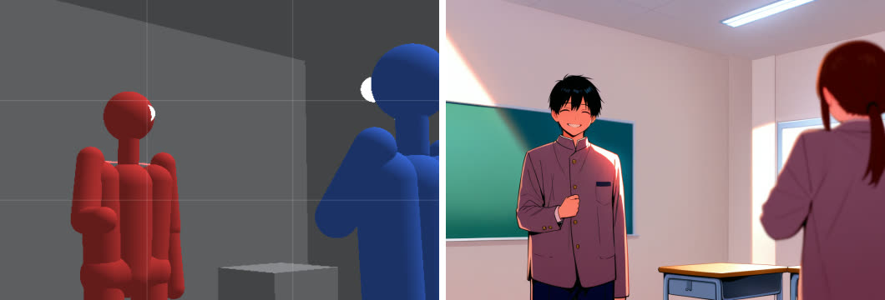

*Left: the camera FrameSeeker chose, on a gray-box stage it built from the scene. Right: an image model (SDXL +
ControlNet) drawing that shot from the structure maps. The camera, the people's places, the back in the foreground
and the desk all carry over.*

Given a story and a number of pictures, an LLM writes the set and the cast, then a storyboard: for each picture, who
is where (one instant on the set) and what the picture must make the viewer understand (her face, what he sees, how
small she is against the bus, the injured ankle). Everything after that is code: a gray-box 3D stage, a camera search
that scores thousands of viewpoints with **deterministic composition rules** from the film and photography literature
(no AI judge), each picture's intent turned into preferences by the devices films use for it (a high angle for
vulnerability, an insert for a detail), and structure maps (depth, line art, OpenPose, a mask per person, effect and
object) for each chosen shot.

Why: image models draw well but cannot be told *where the camera is*, nor *what a picture is for*. A striking frame is
mostly composition (camera height, angle, lens, what frames the subject), and a sequence is a series of such choices,
each serving one thing the story needs. That part is geometry, so it is solved as geometry.

### Does it pick the shots a director picks?

Reference frames from anime episodes are rebuilt as gray-box scenes with the camera that shot them; the question
is where the director's camera ranks among the search's random valid cameras. On six **held-out** episodes, each
scored once with the scorer frozen beforehand (the latest two with the version of `6c7a742`):

| Director's camera in the top 5% | All held-out (6 episodes) | Latest held-out run (2 episodes) |
|---|---|---|
| **FrameSeeker's scorer** | **49 / 89 shots (55%)** | **13 / 30 (43%)** |
| Baseline: Liu et al. 2010's composition score (the published method), same hard constraints, same cameras | 6 / 89 (7%) | 4 / 30 (13%) |
| Baseline: rule of thirds alone, same hard constraints, same cameras | 2 / 89 (2%) | 1 / 30 (3%) |
| Chance | 5% | 5% |

Details, the tuning episodes, and the caveats are in [Evaluation](#evaluation).

**Contents:** [From a story to a strip](#from-a-story-to-a-strip) · [Composition and intent](#composition-and-intent) ·
[How it works](#how-it-works) · [Evaluation](#evaluation) · [The camera scorer](#the-camera-scorer) ·
[Gallery](#gallery) · [Rendering adapters](#rendering-adapters) · [Architecture](#architecture) · [Run](#run) ·
[Status](#status)

---

## From a story to a strip

One command, a three-sentence story, four pictures (`npm run frameseeker -- stories/sprain.txt --panels 4`):

> 放学路上，小遥追着公交车跑过路口，脚下一滑，整个人摔在人行道上。她咬着牙想站起来，右脚踝却一阵钻心的疼，肿得连鞋都快穿不上了。阿凉蹲下来，看了看她的脚，叹了口气：「别逞强了，我背你。」
>
> *(On the way home from school, Xiaoyao runs across the crossing after the bus, slips and falls flat on the
> pavement. She grits her teeth and tries to get up, but her right ankle shoots with pain, so swollen her shoe
> barely fits. Aliang crouches down, looks at her foot and sighs: "Stop pushing it. I'll carry you.")*

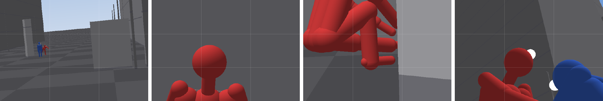

| Panel | The instant (the LLM's beat) | What it must convey (the LLM's intent) | What the camera search found | Score |
|---|---|---|---|---|
| 1 | she slips chasing the bus | `scale(her, against: bus)` | a long lens (85 mm) down the street: the bus big, the two of them small | 0.945 |
| 2 | she tries to get up, in pain | `face(her)`, `vulnerable(her)` | a high angle (30° down) on her bowed face | 0.859 |
| 3 | the swollen ankle | `detail(her, right_foot)` | an insert: the camera 24 cm off the ground, her hand on the ankle | 0.986 |
| 4 | he crouches: "I'll carry you" | `together(him, her)`, `face(him)` | from the ground, looking up at him past her shoulder | 0.797 |

The story is drawn as several pictures because one camera cannot say everything a moment holds: a director cuts
between a low angle on one person and a high angle on the other. So the set and the cast are written once, and each
panel is one **beat** on that set (who is present, where, in which pose) with its own **intent**, at most two things
to convey, searched on its own. Before anything is drawn, the camera tries every panel: two things no single camera
can serve together (a face read up close and the same person small and alone), a thing no camera can show at that
instant, or the same instant drawn twice go back to the LLM with the numbers. The panels are then cut together: while
the same two people face each other, the camera keeps to one side of the line between them (the 180° rule), and two
panels in a row about the same person differ by at least 30° or a shot size, so the cut does not jump (the 30° rule). Set
pieces the staging LLM proposes are kept only if the strip's shots improve as a whole. The LLM chose the ankle insert
itself. The pictures are the gray box; each panel's subject is red.

The run saves its storyboard (`storyboard.json`: the set, each panel's beat and intent); given back to the command,
it replays the strip with no LLM, deterministically. This strip is [`storyboards/sprain.json`](storyboards/sprain.json).

<details>
<summary><b>A second strip: a farewell, and what the camera check changed</b> — an empty classroom at sunset</summary>

> 放学后的教室只剩下两个人。……「明天我就转学了。」阿健把最后一本书塞进书包……小雪坐在自己的座位上，低着头，手指紧紧攥着裙角，一句话也没说。阿健走到教室门口，停了一下。他没有回头，只是背对着她举起右手，竖了个大拇指：「别哭啊，班长。」然后拉开门走了出去。
>
> *(After class, two people left in the classroom. "I'm transferring tomorrow," says Ken, zipping his bag, as lightly
> as talking about the weather. Xue sits at her desk, head down, gripping the hem of her skirt, saying nothing. At the
> door he stops; without turning round, his back to her, he raises a thumbs-up: "Don't cry, class rep." Then he goes.)*

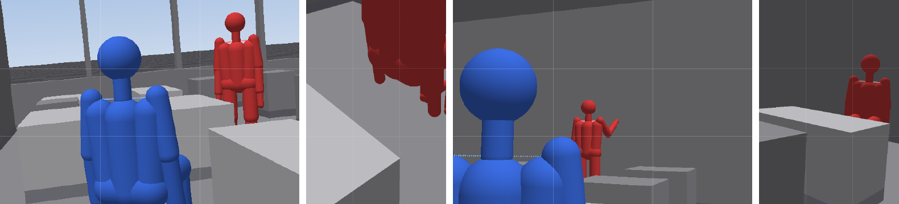

| Panel | Intent | Score | |
|---|---|---|---|
| 1 | `together(Ken, Xue)` | 0.904 | over her shoulder: he says it lightly, she sits across the room |
| 2 | `detail(Xue, hands)` | 0.991 | the hands gripping the skirt: an insert the LLM chose itself |
| 3 | `sees(Xue → Ken)` | 0.818 | over her shoulder again, the same side of the line: Ken at the door, thumb up |
| 4 | `alone(Xue)` | 0.904 | she sits alone in the emptied room |

Before the camera check, the LLM's storyboard for this story paired a face with something no single camera could
also serve: `together(Ken, Xue)` with `face(Ken)` while they sat 3 m apart (0.306), and `alone(Xue)` with `face(Xue)`
(0.374). Now the camera tries the first answer, finds both conflicts, and sends them back with the numbers; the second
answer above is the one kept. The LLM also marked Xue as withdrawn in every panel (she holds back what she feels), so
where she is the subject her back is the share directors give it. [`storyboards/farewell.json`](storyboards/farewell.json).
</details>

---

## Composition and intent

The project's central design decision, and the place to start a discussion of it. Two questions are kept apart:

- **Composition**: is the frame well made? How the things in it are arranged so the picture follows photographic
  practice. This is what the camera scorer measures, against what directors do.
- **Cinematographic intent**: what is the shot for? What must the viewer notice, understand, feel?

Every device a film has (viewpoint, frontality, a high or low angle, an insert, lighting, a vanishing point) is a way
of serving an intent. Without the intent stated, each new feature is a patch for a symptom: back shots scored low, a
gaze feature was built to explain them, and it found no clean signal, because a back shot is right when the shot is
about what the person sees and wrong when it is about their face. The work on automatic cinematography makes the same
split (Jhala & Young 2005: a shot is a communicative act; Lai, Wu, Christie et al. 2014: communicative goals →
techniques → shots; *Look-Before-Move* 2026: an observation contract before the viewpoint search).

So FrameSeeker has three layers, with the intent in a module of its own (`src/intent/`):

```
story ──► INTENT ──────────► DEVICES ─────────────► COMPOSITION ──► camera
          what the viewer     how films convey it     is the frame
          must understand     (low angle for power,   well made?
          (face, sees,        point of view for       (the scorer)
          power, detail, …)   what someone sees, …)
```

An intent is a small structured vocabulary the storyboard LLM writes for each panel: a subject (where the eye goes
first) and at most two things to convey. Devices turn it, deterministically, into preferences over what a camera
shows; the composition scorer is unchanged.

| Intent | Device (what the camera is asked for) | Source |
|---|---|---|
| `face(who)` — read their face | the face within 30–75° of the lens, in three dimensions (a bowed head seen from below counts); medium shot or closer | Mascelli: the close-up for reaction |
| `sees(who, target)` — what they look at | both in one frame (over the shoulder, two-shot), or point of view: the camera at their eyes | Mascelli; Arijon: the external reverse |
| `power(who)` | low angle: the camera below their eyes, looking up | Mascelli; Jhala & Young 2005 |
| `vulnerable(who)` | high angle: the camera above them, looking down | Mascelli |
| `alone(who)` | nobody else in frame, the person small in it | Mascelli: space around a figure |
| `together(who…)` | all in one frame, at sizes alike | Arijon: the two-shot |
| `scale(who, against)` | the big thing in frame, the person a fraction of it | FrameSeeker's scale shot |
| `detail(who, part)` — the injured foot, the hand holding the letter, the eyes | an **insert**: the part fills a good share of the frame; the shot is judged on the part, not the person | Katz: the insert; Mascelli: the cut-in |

Each panel's intent also says who, at that instant, grieves, holds back what they feel or walks away. Directors show
such a person from behind about twice as often as in everyday talk (29% of their shots against 15%, counted over
every shot of 26 passages from three episodes), so for that subject the composition's face table gives backs that
share; still a minority choice (`"back"` in `frameseeker.config.json`, 0 turns it off).

The same scene, different intents, the search's best camera:


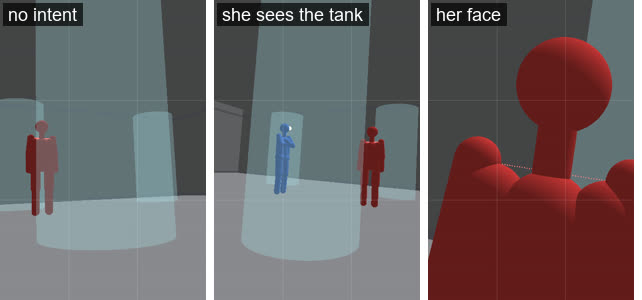

The full draft (the vocabulary and its sources, how inserts change what is judged, what is open, and where the gaze
work stands) is in [`docs/INTENT.md`](docs/INTENT.md).

---

## How it works

Six phases in three modules, with the intent layer beside them:

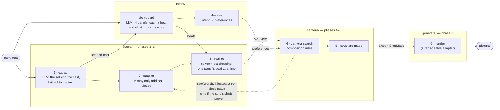

| Phase | Input → output | Who decides |
|---|---|---|
| 1. Extract | story text → **scene JSON**: the place, actors (pose, placement, look), structures, effects, the moment | an LLM, told to add nothing the text does not say; the solver checks its answer |
| Storyboard | story + scene → N **panels**: each a beat (who is present, where, in which pose and expression) and an intent | an LLM; each beat must solve on the set and each intent is checked against its beat (unknown people, effects and parts dropped with a note), then tried with the camera (conflicts, things no camera can show, repeats go back to the LLM) |
| 2. Staging | scene JSON → scene JSON with set pieces added | an LLM proposes; each addition is kept only if the strip's score rises (and drops when taken out) |
| 3. Realize | scene + beat → **gray-box 3D world**: mannequins in poses, boxes, cylinders, glass, beams, the place's dressing | code: a relation solver, then set dressing by the kind of place |
| 4. Camera search | world + preferences → the best *k* **shots** that differ | code: thousands of random cameras, hard constraints, composition terms, the intent's devices, local refinement |
| 5. Structure maps | world + camera → depth, line art, OpenPose, a mask per person / effect / structure / part of the set, each person's planned joints and facing | code: one ray pass |
| 6. Render | scene + shot + maps → picture | a renderer adapter (see [Rendering adapters](#rendering-adapters)) |

Everything from phase 3 on is deterministic: the same storyboard gives the same pictures. The project's own work is
phases 1–5; phase 6 is meant to hand the maps to an existing renderer.

### The gray box

The stage is deliberately plain, but it has to be right where a camera can tell:

- **Rooms** are fixed at the origin (a classroom 9 × 7 × 3 m unless the text says otherwise), so every panel of a
  strip is on the same set; a person placed outside the walls is refused, a camera outside them is rejected, and
  someone pressed against a tall box is moved out and noted. Buildings and vehicles take their real sizes.
- **Poses**: 114, from standing gestures (wave, bow, wipe tears, hold the head, phone call, umbrella) through two
  people (handshake, hug, slap, piggyback, princess carry), fighting, moving (sprint, trip, leap, climb), sitting,
  kneeling and lying. Most are written as directions of the body's parts (spine, head, upper and lower limbs) with
  bone lengths fixed in code and the body set on the ground, so a pose cannot come out with the wrong proportions.
  The LLM picks them by name.
- **Body parts**: the mannequins have hands and feet, and a shot can be about a part (eyes, chest, either hand or
  both, either foot or both). An insert is sampled near the part, must show it, and is judged on the part's size
  in the frame instead of the person's shot scale.

<details>
<summary><b>The pose library</b> — all 114, in order (<code>npm run gallery -- --poses</code>; names in <a href="docs/gallery/poses.txt">poses.txt</a>)</summary>

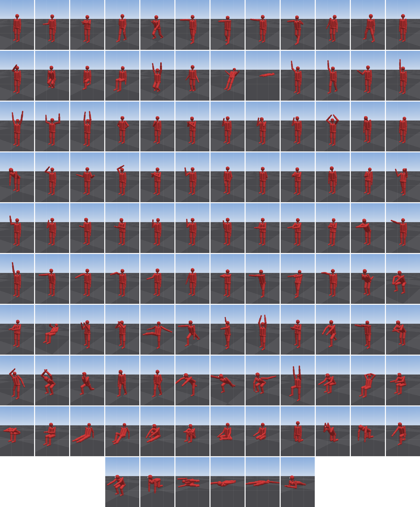
</details>

---

## Evaluation

**Protocol.** Frames are sampled every 10 s from an episode and filtered by fixed rules (story footage, a person at
medium close-up or wider, a measurable ground, no sexualised framing, one frame per shot), then 15 are drawn at
equal intervals: no hand-picking. Each is annotated by hand (horizon, people's crowns and feet) and rebuilt as a
gray-box scene with the camera that shot it, by single-view metrology. The measure: the director's camera's
percentile among the search's random valid cameras for that scene (top 5% = the 95th percentile or above), and
whether the search's own top 3 contain a camera near it. A rejected reference camera counts as a miss. The frames
and annotations are not in the repository (copyrighted footage); the code is in `src/eval/`.

**Baselines.** Each ranks the same random cameras, under the same hard constraints, by one score: Liu et al. 2010's
whole composition score E (rule of thirds, diagonal dominance, visual balance, region size, with the paper's
weights; the published method), or its rule-of-thirds term alone. Chance is 5% in the top 5% and a median
percentile of 50%.

**Tuning and held-out episodes, in order.** The scorer was first built on Hyouka ep 5 (Kyoto Animation) and
A Certain Scientific Railgun S ep 24 (J.C.Staff). Each held-out episode below was annotated first, then scored
**once** with the scorer frozen at the named commit, and only then joined the tuning set. After Log Horizon the
action shot-scale prior was changed (the episode showed action shots are wider); Mahouka and GATE were scored with
that change already frozen. Between GATE and the last two episodes the scorer was changed using all six earlier
episodes (a camera-tilt prior, the mannequin's proportions, room floors, glass); Hyouka ep 16 and Mahouka ep 25 then
measured that version. They come from series already used for tuning (same studios), so they are less independent
than a new series would be; their frames themselves were never seen.

| Held-out episode | Studio | Scorer frozen at | FrameSeeker: top 5% | Liu et al.: top 5% | Thirds: top 5% | FrameSeeker: top 3 |
|---|---|---|---|---|---|---|
| Oregairu S1 ep 12 | Brain's Base | `4996aa6` | 8 / 15 | 1 / 15 | 1 / 15 | 3 / 15 |
| Log Horizon ep 4 | Satelight | `763dc6c` | 5 / 14 | 0 / 14 | 0 / 14 | 5 / 14 |
| Mahouka ep 22 | Madhouse | `0d54cc0` | 12 / 15 | 1 / 15 | 0 / 15 | 4 / 15 |
| GATE ep 6 | A-1 Pictures | `0d54cc0` | 11 / 15 | 0 / 15 | 0 / 15 | 1 / 15 |
| Hyouka ep 16 | Kyoto Animation | `6c7a742` | 10 / 15 | 4 / 15 | 1 / 15 | 3 / 15 |
| Mahouka ep 25 | Madhouse | `6c7a742` | 3 / 15 | 0 / 15 | 0 / 15 | 0 / 15 |
| **Total** | | | **49 / 89 (55%)** | **6 / 89 (7%)** | **2 / 89 (2%)** | 16 / 89 |

The baselines were computed with each frozen commit's own code, on the same cameras. Median percentile per episode
(Oregairu / Log Horizon / Mahouka 22 / GATE / Hyouka 16 / Mahouka 25): FrameSeeker 95 / 92 / 99 / 97 / 98 / 87%,
Liu et al. 79 / 41 / 49 / 53 / 80 / 40%, thirds 76 / 49 / 63 / 47 / 81 / 71%.

Mahouka ep 25 (3 / 15) is the weakest episode so far. Its misses are the known weak spots, not new ones: backs and
profiles (5 shots lose most on the face-angle term), small figures in wide shots, subjects cut at a joint by the
frame's edge, and one near top-down shot whose pitch had to be estimated. The scorer was not changed for it.

**After the latest held-out run** the two episodes joined the tuning set (eight episodes, 119 shots), and two terms
were revised from the data: the face-angle table re-measured against the search's random cameras, and the joint-cut
term dropped (see [the scorer](#the-camera-scorer)). With no unseen episodes left, the change was checked by
leave-one-episode-out cross-validation (each table estimated without the episode it is tested on): 75 / 119 in the
top 5% against 72 / 119 for the version before, no episode worse. Five variants were tried and the best kept, so
that gain is somewhat optimistic; **the current version has no held-out measurement of its own yet.**

**The eight episodes the current scorer was tuned on — in-sample, for reference.**

| On all 118 rebuilt shots (119 annotated, 1 rebuild failure) | FrameSeeker | Liu et al. | Thirds |
|---|---|---|---|
| Director's camera in the top 5% | 75 (64%) | 12 (10%) | 7 (6%) |
| Median percentile | 98% | 55% | 66% |
| Director's camera among the search's top 3 | 38 | 9 | 8 |

**What this says, and what it does not.**
- Neither picture-plane measure, the published one or its simplest rule, separates the director's camera from the
  others: both sit near chance. That is not a fault of Liu et al.'s method, which scores how a photograph is
  arranged on its plane; choosing a camera is mostly about what that plane cannot see: how far, how high, from
  which side, at what tilt. The scorer's other terms (shot scale, face angle, tilt, occlusion, …) carry the signal.
- Each held-out figure belongs to the version frozen for it; the latest (13 / 30) comes from two episodes of series
  already used for tuning.
- 89 held-out shots from six episodes is a small sample, and every episode is anime.
- Backs and wide shots stay weak, and the data says why: directors choose them less often than a random camera
  would, so a prior learned from what directors usually do ranks them low. Telling when a back is the right shot
  (someone looking at what the shot is about) is a question of intent, not of composition: see
  [Composition and intent](#composition-and-intent).
- "Top 3" is a harsh measure: there is usually more than one good camera, and the search's best is often a
  different, equally valid one (GATE: 11 / 15 in the top 5%, 1 / 15 in the top 3).
- Other known weak spots: the shot scale of action scenes; a person lying down can be "visible" from a camera that
  cannot read them.

`npm run eval` reproduces the all-episode numbers (`--objective liu` or `--objective thirds` for the baselines),
given the local annotations.

---

## The camera scorer

Hard constraints first (the subject and the payoff visible, the action line not running into the lens, …), then
terms in [0, 1] combined by a weighted geometric mean, each from a published rule or measured data:

- **picture-plane composition**: rule of thirds for subjects and lines, diagonal dominance, visual balance, region
  size (Liu, Chen, Wolf, Cohen-Or 2010, with the paper's constants);
- **shot scale**: the frequencies of film shot scales (Cutting 2015, 13 956 frames from 48 films); action shots blend
  these with reference action shots;
- **face angle**: how often reference shots show the front, a profile, three quarters from behind and the back,
  over the search's random cameras (117 shots; the square root of the ratio, as the face angle is correlated with
  other terms);
- **camera tilt**, the same way: near top-down shots (over 45° down) are 2 of 88 reference shots against 13% of
  random cameras; other tilts are as common as chance, or too rare among random cameras to judge;
- **framing, lead room, foreshortening** of the action line, **occlusion** of the subject by nearer people or glass
  (Bares et al. 2000), **mergers**.

Rules the data did not support are left out. "Never crop the subject at a joint" (Katz) was a term until the
reference shots showed, within each shot scale, a joint at the frame's edge as often as random cameras do.

The weights depend on the scene's rough shot type (scale, action, emotion, reveal), the first, coarse form of intent;
what a shot is for is now the intent layer's job ([Composition and intent](#composition-and-intent)).

---

## Gallery

Single instants: every scene in [`scenes/`](scenes/), run through phases 3–5 (`npm run gallery -- scenes/*.json`;
deterministic, no model, no network), none left out. These scenes carry only the coarse shot type, no intent. For each: the top three shots as gray-box previews (people in colours, the focus
in red, a thirds grid), and the first shot's structure maps, which is what a renderer receives: **depth, line art /
OpenPose, region masks** (each person, effect, object and part of the set in its own colour). Click a scene to open
it. The scores and cameras of every shot are in [`docs/gallery/gallery.json`](docs/gallery/gallery.json).

<details open>
<summary><b>Classroom talk</b> — after class, one student talks and smiles, the other listens with arms crossed, doubtful (intent: emotion)</summary>

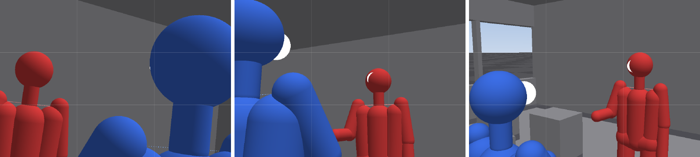

</details>

<details>
<summary><b>Rooftop strike</b> — on an office rooftop at night, a punch, and the other side-steps it (intent: action)</summary>


</details>

<details>
<summary><b>Beam clash</b> — an empty street between glass towers at sunset; a beam from one hand grazes the other's head and melts the tower behind (intent: scale)</summary>

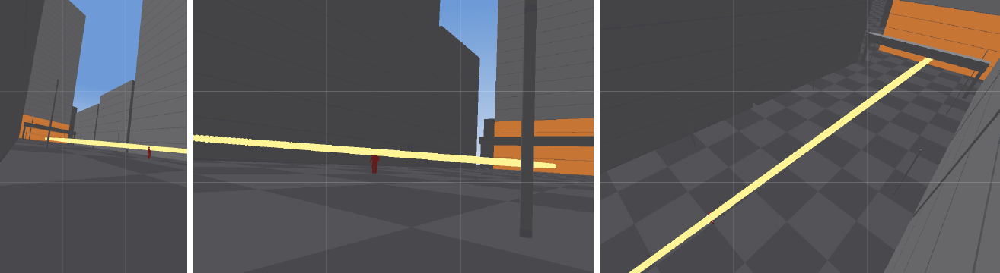
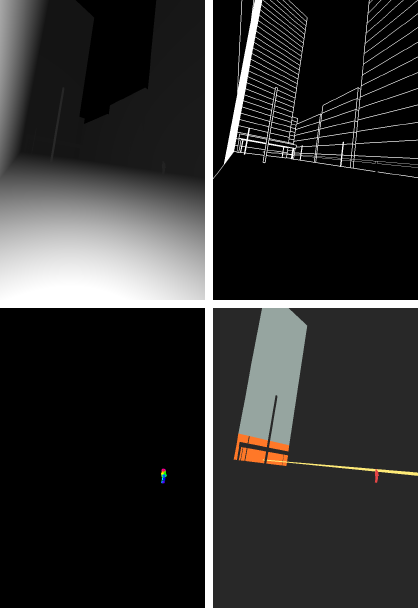

A scale shot: the person is meant to be small against the street, the beam and the melting tower.
</details>

<details>
<summary><b>Gantry</b> — standing on a steel gantry over a city street, a figure points and lightning leaps from the hand (intent: scale)</summary>

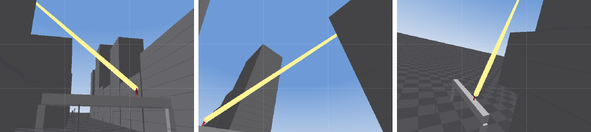
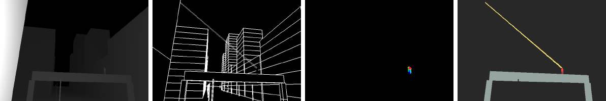
</details>

<details>
<summary><b>Look back</b> — a quiet residential street at sunset; someone looks back over the shoulder (intent: emotion)</summary>

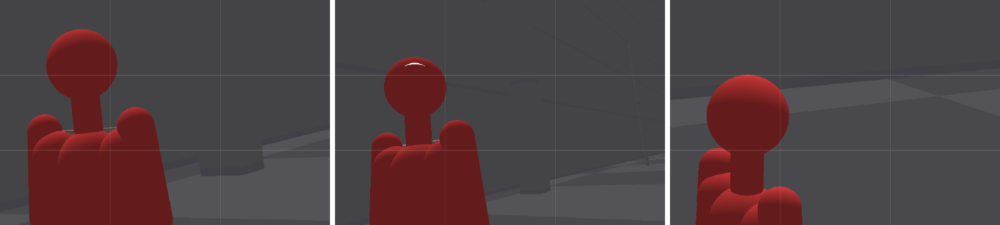
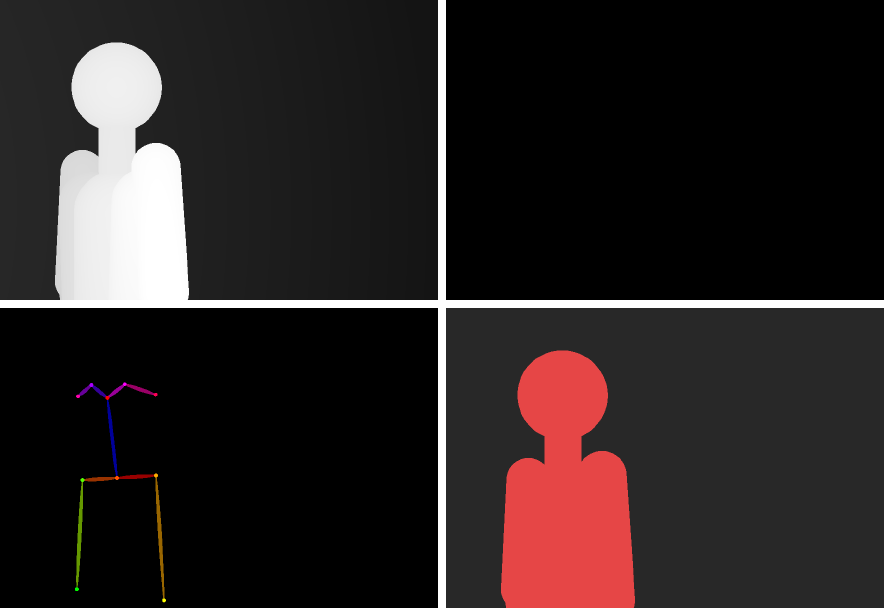
</details>

<details>
<summary><b>Lab tanks</b> — an underground lab at night: a researcher faces a row of glass tanks, her assistant behind her (intent: reveal)</summary>


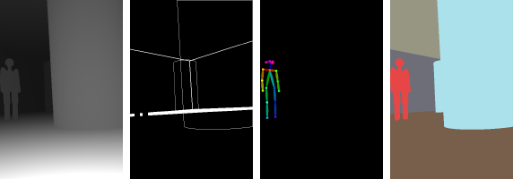

The tanks are glass: the people behind them stay visible to the camera's checks.
</details>

<details>
<summary><b>Ward</b> — a dim hospital ward at night: a girl stands by three children asleep in glass life-support capsules (intent: emotion)</summary>

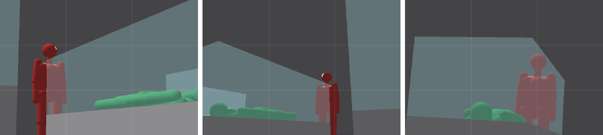
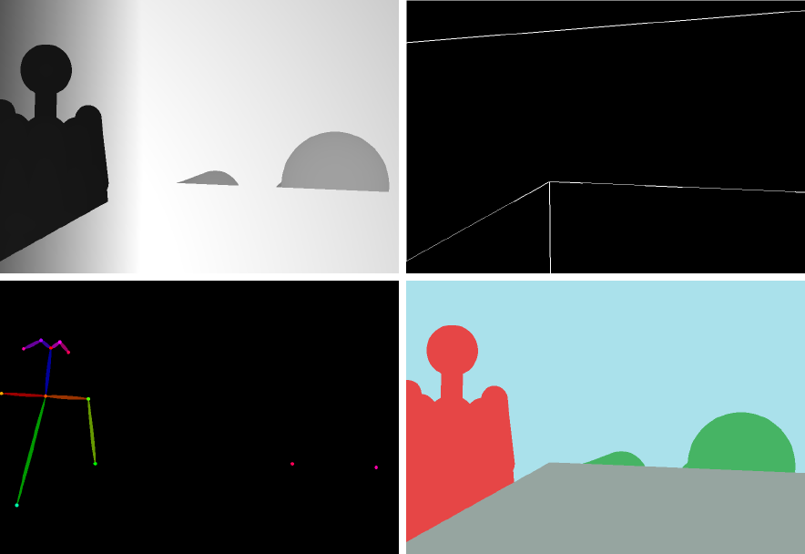

A known weak spot: from this low a camera the children lying down are visible, but hard to read.
</details>

---

## Rendering adapters

A renderer gets the scene, the shot and its maps, and makes its own prompt (`src/generate/types.ts`): an
image-board model wants tags, another XML or sentences. Which renderer to use is open; the first adapter is
archived on branch [`archive/phase6-sdxl-comfy`](../../tree/archive/phase6-sdxl-comfy) (tag
`phase6-sdxl-comfy-v1`): SDXL + ControlNet on ComfyUI, run on Comfy Cloud.

Some of its pictures, each beside the gray-box shot it was drawn from (gray box at the time of the run):

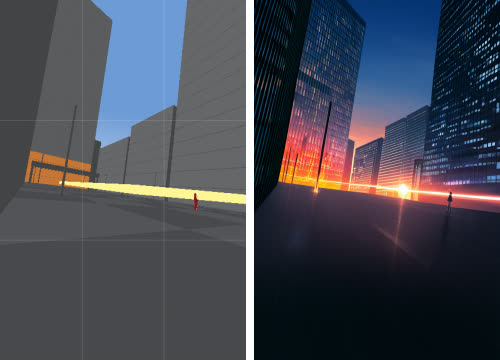


What that adapter learned, as requirements for the next one:

- **Each thing's words only in its own region.** People, effects, structures and the labelled parts of the set each
  get their own prompt inside their own mask; the free-text description of the place never reaches a wall. With
  everyone in one prompt, hair and gender swapped between people, "melting" melted whatever the model chose, and
  "evening light through the windows" put windows on gray-box walls.
- **Which way someone faces comes from the pose, not the depth** (a featureless mannequin has the same depth front
  and back); a person seen from behind gets no expression tags.
- **The set loosely, the people firmly**: firm depth on bare stand-in walls fights the prompt (windows painted flat).
- **Thin effects need more than structure maps** (a beam is a few pixels of depth): a colour hint helped.
- **Glass**: its shape in the depth, except over a person behind it.
- **Measure, then pick**: the image model leaned to drawing girls and no prompt lever fixed it. Drawing 4 candidates
  and measuring each with existing instruments (DWPose for who is where and facing which way, a Danbooru tagger for
  each person's gender), compared with the plan by plain geometry, picked a right picture whenever there was one.

---

## Architecture

### Modules and what each may use

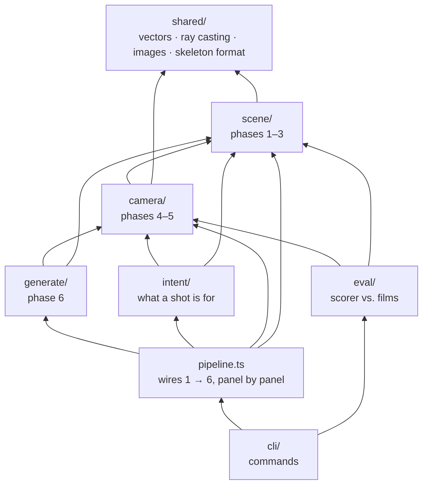

An arrow means "uses". Two rules, checked by `tests/architecture.test.ts` on every test run:

1. **A module is used only through its `index.ts`.** Everything else in it is private and can be rewritten freely,
   so one module can be improved (or replaced) without touching the others. (`shared/` is a library of independent
   files and may be imported file by file.)
2. **Dependencies point down only.** The scene never knows the camera exists; the camera never knows how its maps
   are rendered, nor that intents exist: it measures what a camera shows and takes preferences from outside.

The one place the scene needs the camera, staging (phase 2 asks "does this set piece make a better shot?"), the
camera's `rate` is passed in as a function by the pipeline, so the dependency still points down.

### What crosses each boundary

| From → to | What | Type (defined in) |
|---|---|---|
| story → scene | the text, an optional focus ("draw the moment when…"), people's descriptions, the number of panels | `extractScene(text, …)` |
| story + scene → intent | the text and the extracted set and cast → each panel's beat and intent | `storyboard(text, scene, chat, n)` → `Panel[]` (intent/storyboard.ts) |
| panel → scene | one instant on the set: who is present, where, pose, expression; the set's structures stay where they were solved | `Beat` (scene/types.ts), `atBeat(scene, beat)` |
| scene → camera | the solved world: the scene JSON, its exact geometry (actors' joints, structures, beams, blasts, damage), the ray-castable primitives | `World3D` (scene/index.ts) |
| camera → scene, staging only | the best shot's score and terms, through an injected function | `Rating` (scene/index.ts) |
| camera → intent | what a camera shows, measured: each person's and thing's share in frame and seen, place, size; each person's face angle, the camera's height against their eyes, whether what they look at is in frame | `View` (camera/view.ts) |
| intent → camera | the shot's intent as preferences, each folded into the score with a weight | `Preference` (camera/view.ts), from `preferences(intent)` |
| camera → generate | a shot (camera, score, measurements) and its maps (images, region masks, planned people) | `Shot`, `ShotMaps` (camera/index.ts) |
| generate → caller | the picture and whatever the renderer reports | `GenerateResult` (generate/types.ts) |
| scene, camera → eval | `realize`; `scorer(world, objective)`: score a camera, draw the search's random cameras, search; camera geometry | camera/index.ts |

### Inside each module

**`shared/`** — no dependencies.
`vec.ts` 3D vectors · `geom.ts` primitives (box, capsule / cylinder, sphere; glass) and ray casting · `skeleton.ts`
the OpenPose body-18 format every module speaks · `image.ts`, `png.ts` raw images and PNG.

**`scene/`** — phases 1–3. Public: `extractScene`, `stageScene` (or both as `buildScenes`), `realize`, `atBeat`, the
scene and world types, the pose library, the body parts.
`types.ts` the scene JSON and beats · `llm/` extraction (`extract.ts`), staging proposals (`stage.ts`), the
vocabulary shown to the LLM, written from the code (`vocab.ts`), a chat client (`chat.ts`) · `judge.ts` keeps a
staging operation only where it measurably helps · `solve.ts` relations → exact geometry, the room's walls ·
`beat.ts` one instant of a strip on the same set · `poses.ts` the pose library and the builder that writes a pose
from directions · `parts.ts` hands, feet and the parts an insert can be about · `attention.ts` what draws the eye to
the focus (a pointing hand, a gaze) · `dress.ts` dressing by the kind of place (streets of buildings, a room's
shell, a classroom's blackboard and desks).

**`camera/`** — phases 4–5. Public: `shoot`, `rate`, `rateCamera`, `scorer`, `measure`, `maps`, `preview`, the
continuity gates, camera geometry. `camera.ts` the pinhole camera and projection · `search.ts` sampling and local
refinement · `score.ts` hard constraints and score terms (the face table, and its lift for a withdrawn subject) ·
`composition2d.ts` picture-plane composition (Liu et al. 2010) · `view.ts` what a camera shows, and preferences from
outside · `continuity.ts` the 180° and 30° rules between shots · `maps.ts` the structure maps · `render.ts` the
gray-box preview for people.

**`intent/`** — what a shot is for. Public: `storyboard`, `review`, `checkIntent`, `preferences`, `backLift`,
`applyIntent`, the vocabulary. `types.ts` the intents · `devices.ts` the ways films convey each, as preferences, with
sources · `storyboard.ts` the panels from a story (LLM: each a beat and an intent, checked against the scene) ·
`review.ts` the panels tried with the camera (conflicts, things no camera can show, repeats) · `apply.ts` the intent
as the scene's moment.

**`generate/`** — phase 6. Public: the renderer contract (`Generator`, `GenerateInput`, `GenerateResult`).

**`eval/`** — the scorer against films. Public: `evalRef`, `rebuild`.
`refs.ts` rebuilds an annotated film frame as a gray-box scene and its camera · `eval.ts` ranks that camera.

**`pipeline.ts`** — `runText` (phases 1–6, one panel or a strip), `runStoryboard` (3–6 from a saved storyboard) and
`runScene` (3–6, one instant). **`cli/`** — the commands below.

---

## Run

Node ≥ 24 (runs TypeScript directly, no build), no runtime dependencies. A story needs an OpenAI-compatible LLM
(`VENICE_API_KEY`); everything from a scene or a storyboard runs offline.

```
npm install
npm test                                                 # includes the architecture check
npm run frameseeker -- stories/sprain.txt --panels 4     # a story as a strip of 4 → out/run-sprain/strip.png, storyboard.json
npm run frameseeker -- storyboards/sprain.json           # replay a saved strip: no LLM, the same pictures
npm run frameseeker -- stories/rooftop-chase.txt         # a story as one picture, its intent written by the LLM
npm run frameseeker -- scenes/classroom-talk.json        # one instant from a scene file (phases 3–5, no LLM)
```

| Command | Phases | For |
|---|---|---|
| `npm run frameseeker -- <story.txt \| scene.json \| storyboard.json>` | 1–5 from a story, 3–5 from a file; 6 with `--generator` | the whole pipeline. `--panels N` draws a story as N pictures; with one, `--intent intent.json` sets the shot's intent and `--no-intent` skips it; `--k` cameras per panel |
| `npm run stage -- <story.txt>` | 1–3 | inspecting extraction and staging |
| `npm run shot -- <scene.json> [--intent intent.json]` | 3–5 | inspecting the camera search: previews, maps, every score term (and the intent's devices; examples in `intents/`) |
| `npm run gallery -- <scene.json \| storyboard.json ...> [--poses]` | 3–5 | the README's figures (`docs/gallery/`): a scene's top shots and maps, a storyboard's strip, the pose sheet |
| `npm run eval [-- --objective liu\|thirds]` | — | the scorer (or a baseline) against the annotated film frames (local data) |
| `npm run refs:select` | — | sampling reference frames by the fixed rules (local data) |

Each shot comes out as a gray-box preview, depth, line art, OpenPose, a mask per region (each person, effect,
structure and labelled part of the set), each person's planned joints and facing, and a colour hint when an effect
is in frame; with several panels each file is prefixed `panel-<i>-`. `report.json` has every panel's beat, intent,
notes, cameras and scores. Example stories are in `stories/`, scenes in `scenes/`, saved strips in `storyboards/`.

## Status

Phases 1–5 work end to end, from a story to a strip of panels, each with its own beat and intent, and are
deterministic from phase 3 on. The renderer for phase 6 is being chosen; an SDXL adapter is archived.

Open, in rough order:

- **Measured, not assumed**: the devices for most intents (a low angle for power, a high one for vulnerability) come
  from the textbooks and are not yet measured on films the way the back shots of grief and leaving were; the insert's
  preferred part size is a first choice; the poses are written by hand, not captured.
- **A held-out run of the current scorer** on unseen episodes.
- **Across cuts**: intents that span several panels (each shot closer as tension rises) are not modelled; panels are
  only kept on one side of the line and apart by 30°.
- Light and leading lines are not modelled.
