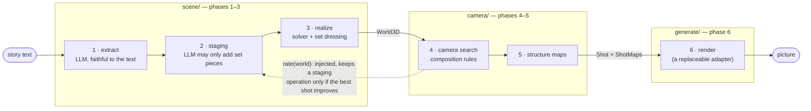
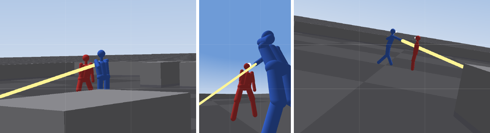
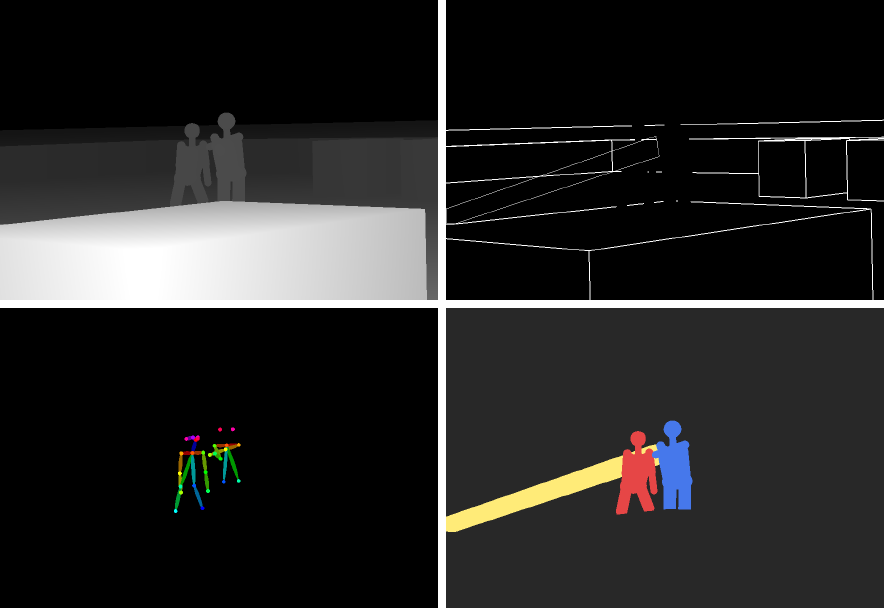
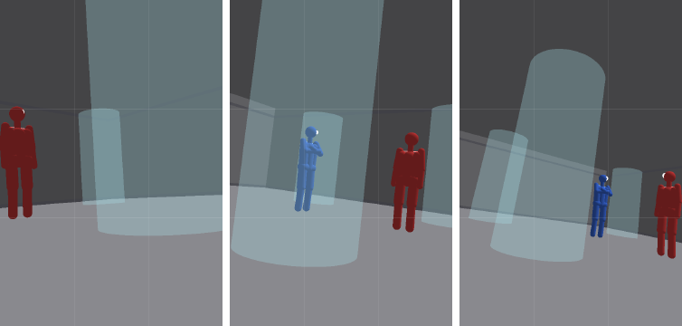
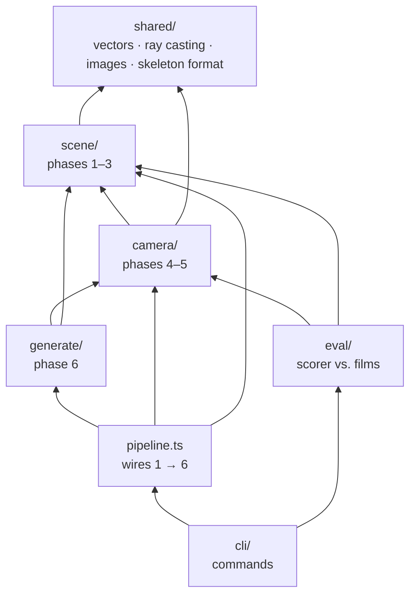
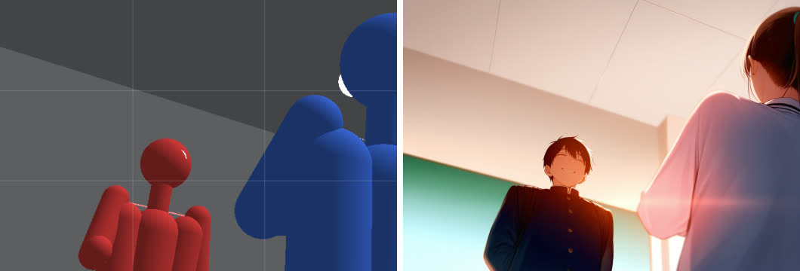
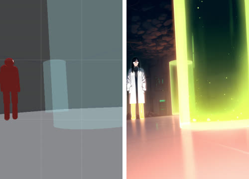

# FrameSeeker

**A shot planner: from a moment in a story to camera placements and structure maps for any image renderer.**


*Left: the camera FrameSeeker chose, on a gray-box stage it built from the scene. Right: an image model (SDXL +
ControlNet) drawing that shot from the structure maps. The camera, the people's places, the back in the foreground
and the desk all carry over.*

An LLM writes the moment as a scene (who stands where, what hits what); code builds a gray-box 3D stage of it; a
camera search scores thousands of viewpoints with **deterministic composition rules** from the film and photography
literature (no AI judge); and the best shots come out as structure maps (depth, line art, OpenPose, a mask per
person, effect and object) that any image renderer can take.

Why: image models draw well but cannot be told *where the camera is*. A striking frame is mostly composition:
camera height, angle, lens, what frames the subject. That part is geometry, so it is solved as geometry.

### Does it pick the shots a director picks?

Reference frames from anime episodes are rebuilt as gray-box scenes with the camera that shot them; the question
is where the director's camera ranks among the search's random valid cameras. On four **held-out** episodes, each
scored once with the scorer frozen beforehand:

| | Director's camera in the top 5% |
|---|---|
| **FrameSeeker's scorer** | **36 / 59 shots (61%)** |
| Baseline: Liu et al. 2010's composition score (the published method), same hard constraints, same cameras | 2 / 59 (3%) |
| Baseline: rule of thirds alone, same hard constraints, same cameras | 1 / 59 (2%) |
| Chance | 5% |

Details, the tuning episodes, and the caveats are in [Evaluation](#evaluation).

**Contents:** [How it works](#how-it-works) · [Gallery](#gallery) · [Architecture](#architecture) ·
[The camera scorer](#the-camera-scorer) · [Evaluation](#evaluation) · [Rendering adapters](#rendering-adapters) ·
[Run](#run)

---

## How it works

Six phases, in three modules:



| Phase | Input → output | Who decides |
|---|---|---|
| 1. Extract | story text → **scene JSON**: actors (pose, placement, look), structures, effects, the moment (focus, intent) | an LLM, told to add nothing the text does not say; the solver checks its answer |
| 2. Staging | scene JSON → scene JSON with set pieces added | an LLM proposes; each addition is kept only if the camera score rises (and drops when taken out) |
| 3. Realize | scene JSON → **gray-box 3D world**: mannequins in poses, boxes, cylinders, glass, beams, the place's dressing | code: a relation solver, then set dressing by the kind of place |
| 4. Camera search | world → the best *k* **shots** that differ | code: thousands of random cameras, hard constraints, composition terms, local refinement |
| 5. Structure maps | world + camera → depth, line art, OpenPose, a mask per person / effect / structure / part of the set, each person's planned joints and facing | code: one ray pass |
| 6. Render | scene + shot + maps → picture | a renderer adapter (see [Rendering adapters](#rendering-adapters)) |

Phases 3–5 are deterministic: the same scene gives the same shots. The project's own work is phases 1–5;
phase 6 is meant to hand the maps to an existing renderer.

---

## Gallery

Every scene in [`scenes/`](scenes/), run through phases 3–5 (`npm run gallery -- scenes/*.json`; deterministic, no
model, no network), none left out. For each: the top three shots as gray-box previews (people in colours, the focus
in red, a thirds grid), and the first shot's structure maps, which is what a renderer receives: **depth, line art /
OpenPose, region masks** (each person, effect, object and part of the set in its own colour). Click a scene to open
it. The scores and cameras of every shot are in [`docs/gallery/gallery.json`](docs/gallery/gallery.json).

<details open>
<summary><b>Classroom talk</b> — after class, one student talks and smiles, the other listens with arms crossed, doubtful (intent: emotion)</summary>


</details>

<details>
<summary><b>Rooftop strike</b> — on an office rooftop at night, a punch, and the other side-steps it (intent: action)</summary>



</details>

<details>
<summary><b>Beam clash</b> — an empty street between glass towers at sunset; a beam from one hand grazes the other's head and melts the tower behind (intent: scale)</summary>


A scale shot: the person is meant to be small against the street, the beam and the melting tower.
</details>

<details>
<summary><b>Gantry</b> — standing on a steel gantry over a city street, a figure points and lightning leaps from the hand (intent: scale)</summary>


</details>

<details>
<summary><b>Look back</b> — a quiet residential street at sunset; someone looks back over the shoulder (intent: emotion)</summary>


</details>

<details>
<summary><b>Lab tanks</b> — an underground lab at night: a researcher faces a row of glass tanks, her assistant behind her (intent: reveal)</summary>




The tanks are glass: the people behind them stay visible to the camera's checks.
</details>

<details>
<summary><b>Ward</b> — a dim hospital ward at night: a girl stands by three children asleep in glass life-support capsules (intent: emotion)</summary>


A known weak spot: from this low a camera the children lying down are visible, but hard to read.
</details>

---

## Architecture

### Modules and what each may use



An arrow means "uses". Two rules, checked by `tests/architecture.test.ts` on every test run:

1. **A module is used only through its `index.ts`.** Everything else in it is private and can be rewritten freely,
   so one module can be improved (or replaced) without touching the others. (`shared/` is a library of independent
   files and may be imported file by file.)
2. **Dependencies point down only.** The scene never knows the camera exists; the camera never knows how its maps
   are rendered.

The one place the scene needs the camera, staging (phase 2 asks "does this set piece make a better shot?"), the
camera's `rate` is passed in as a function by the pipeline, so the dependency still points down.

### What crosses each boundary

| From → to | What | Type (defined in) |
|---|---|---|
| story → scene | the text, an optional focus ("draw the moment when…"), people's descriptions | `buildScenes(text, …)` |
| scene → camera | the solved world: the scene JSON, its exact geometry (actors' joints, structures, beams, blasts, damage), the ray-castable primitives | `World3D` (scene/index.ts) |
| camera → scene, staging only | the best shot's score and terms, through an injected function | `Rating` (scene/index.ts) |
| camera → generate | a shot (camera, score, measurements) and its maps (images, region masks, planned people) | `Shot`, `ShotMaps` (camera/index.ts) |
| generate → caller | the picture and whatever the renderer reports | `GenerateResult` (generate/types.ts) |
| scene, camera → eval | `realize`; `scorer(world, objective)`: score a camera, draw the search's random cameras, search; camera geometry | camera/index.ts |

### Inside each module

**`shared/`** — no dependencies.
`vec.ts` 3D vectors · `geom.ts` primitives (box, capsule / cylinder, sphere; glass) and ray casting · `skeleton.ts`
the OpenPose body-18 format every module speaks · `image.ts`, `png.ts` raw images and PNG.

**`scene/`** — phases 1–3. Public: `buildScenes`, `realize`, the scene and world types, the pose library.
`types.ts` the scene JSON · `llm/` extraction (`extract.ts`), staging proposals (`stage.ts`), the vocabulary shown
to the LLM, written from the code (`vocab.ts`), a chat client (`chat.ts`) · `judge.ts` keeps a staging operation
only where it measurably helps · `solve.ts` relations → exact geometry · `poses.ts` the pose library ·
`dress.ts` dressing by the kind of place (streets of buildings, a room's shell, a classroom's blackboard and desks).

**`camera/`** — phases 4–5. Public: `shoot`, `rate`, `rateCamera`, `scorer`, `maps`, `preview`, camera geometry.
`camera.ts` the pinhole camera and projection · `search.ts` sampling and local refinement · `score.ts` hard
constraints and score terms · `composition2d.ts` picture-plane composition (Liu et al. 2010) · `maps.ts` the
structure maps · `render.ts` the gray-box preview for people.

**`generate/`** — phase 6. Public: the renderer contract (`Generator`, `GenerateInput`, `GenerateResult`).

**`eval/`** — the scorer against films. Public: `evalRef`, `rebuild`.
`refs.ts` rebuilds an annotated film frame as a gray-box scene and its camera · `eval.ts` ranks that camera.

**`pipeline.ts`** — `runText` (phases 1–6) and `runScene` (3–6). **`cli/`** — the commands below.

---

## The camera scorer

Hard constraints first (the subject and the payoff visible, the action line not running into the lens, …), then
terms in [0, 1] combined by a weighted geometric mean, each from a published rule or measured data:

- **picture-plane composition**: rule of thirds for subjects and lines, diagonal dominance, visual balance, region
  size (Liu, Chen, Wolf, Cohen-Or 2010, with the paper's constants);
- **shot scale**: the frequencies of film shot scales (Cutting 2015, 13 956 frames from 48 films); action shots blend
  these with reference action shots;
- **face angle**: how often reference shots show the front, three-quarter and back, over a uniform camera;
- **camera tilt**, the same way: near top-down shots (over 45° down) are 2 of 88 reference shots against 13% of
  random cameras; other tilts are as common as chance, or too rare among random cameras to judge;
- **framing, lead room, foreshortening** of the action line, **joint cuts** on the subject, **occlusion** of the
  subject by nearer people or glass (Bares et al. 2000), **mergers**.

The weights depend on the shot's intent (scale, action, emotion, reveal).

---

## Evaluation

**Protocol.** Frames are sampled every 10 s from an episode and filtered by fixed rules (story footage, a person at
medium close-up or wider, a measurable ground, no sexualised framing, one frame per shot), then 15 are drawn at
equal intervals: no hand-picking. Each is annotated by hand (horizon, people's crowns and feet) and rebuilt as a
gray-box scene with the camera that shot it, by single-view metrology. The measure: the director's camera's
percentile among the search's random valid cameras for that scene (top 5% = the 95th percentile or above), and
whether the search's own top 3 contain a camera near it. A rejected reference camera counts as a miss. The frames
and annotations are not in the repository (copyrighted footage); the code is in `src/eval/`.

**Baselines.** Each ranks the same random cameras, under the same hard constraints, by one score: Liu et al. 2010's
whole composition score E (rule of thirds, diagonal dominance, visual balance, region size, with the paper's
weights; the published method), or its rule-of-thirds term alone. Chance is 5% in the top 5% and a median
percentile of 50%.

**Tuning and held-out episodes, in order.** The scorer was first built on Hyouka ep 5 (Kyoto Animation) and
A Certain Scientific Railgun S ep 24 (J.C.Staff). Each held-out episode below was annotated first, then scored
**once** with the scorer frozen at the named commit, and only then joined the tuning set. After Log Horizon the
action shot-scale prior was changed (the episode showed action shots are wider); Mahouka and GATE were scored with
that change already frozen.

| Held-out episode | Studio | Scorer frozen at | FrameSeeker: top 5% | Liu et al.: top 5% | Thirds: top 5% | FrameSeeker: top 3 |
|---|---|---|---|---|---|---|
| Oregairu S1 ep 12 | Brain's Base | `4996aa6` | 8 / 15 | 1 / 15 | 1 / 15 | 3 / 15 |
| Log Horizon ep 4 | Satelight | `763dc6c` | 5 / 14 | 0 / 14 | 0 / 14 | 5 / 14 |
| Mahouka ep 22 | Madhouse | `0d54cc0` | 12 / 15 | 1 / 15 | 0 / 15 | 4 / 15 |
| GATE ep 6 | A-1 Pictures | `0d54cc0` | 11 / 15 | 0 / 15 | 0 / 15 | 1 / 15 |
| **Total** | | | **36 / 59 (61%)** | **2 / 59 (3%)** | **1 / 59 (2%)** | 13 / 59 |

The baselines were computed with each frozen commit's own code, on the same cameras. Median percentile per episode
(Oregairu / Log Horizon / Mahouka / GATE): FrameSeeker 95 / 92 / 99 / 97%, Liu et al. 79 / 41 / 49 / 53%, thirds
76 / 49 / 63 / 47%.

**All six episodes, current scorer — includes the tuning data.**

| On all 88 rebuilt shots (89 annotated, 1 rebuild failure) | FrameSeeker | Liu et al. | Thirds |
|---|---|---|---|
| Director's camera in the top 5% | 59 (67%) | 8 (9%) | 6 (7%) |
| Median percentile | 98% | 55% | 65% |
| Director's camera among the search's top 3 | 24 | 6 | 7 |

**What this says, and what it does not.**
- Neither picture-plane measure, the published one or its simplest rule, separates the director's camera from the
  others: both sit near chance. That is not a fault of Liu et al.'s method, which scores how a photograph is
  arranged on its plane; choosing a camera is mostly about what that plane cannot see: how far, how high, from
  which side, at what tilt. The scorer's other terms (shot scale, face angle, tilt, occlusion, …) carry the signal.
- The held-out figures belong to the frozen versions. The scorer has changed since the last held-out run, using
  all six episodes (a camera-tilt prior measured on all 88 shots; the mannequin's proportions; room floors; glass),
  so **the current version has no held-out measurement yet**; the next episodes will give it one.
- 59 held-out shots from four episodes is a small sample, and every episode is anime.
- "Top 3" is a harsh measure: there is usually more than one good camera, and the search's best is often a
  different, equally valid one (GATE: 11 / 15 in the top 5%, 1 / 15 in the top 3).
- Known weak spots: backs and wide establishing shots; the shot scale of action scenes; a person lying down can be
  "visible" from a camera that cannot read them.

`npm run eval` reproduces the all-episode numbers (`--objective liu` or `--objective thirds` for the baselines),
given the local annotations.

---

## Rendering adapters

A renderer gets the scene, the shot and its maps, and makes its own prompt (`src/generate/types.ts`): an
image-board model wants tags, another XML or sentences. Which renderer to use is open; the first adapter is
archived on branch [`archive/phase6-sdxl-comfy`](../../tree/archive/phase6-sdxl-comfy) (tag
`phase6-sdxl-comfy-v1`): SDXL + ControlNet on ComfyUI, run on Comfy Cloud.

Some of its pictures, each beside the gray-box shot it was drawn from (gray box at the time of the run):





What that adapter learned, as requirements for the next one:

- **Each thing's words only in its own region.** People, effects, structures and the labelled parts of the set each
  get their own prompt inside their own mask; the free-text description of the place never reaches a wall. With
  everyone in one prompt, hair and gender swapped between people, "melting" melted whatever the model chose, and
  "evening light through the windows" put windows on gray-box walls.
- **Which way someone faces comes from the pose, not the depth** (a featureless mannequin has the same depth front
  and back); a person seen from behind gets no expression tags.
- **The set loosely, the people firmly**: firm depth on bare stand-in walls fights the prompt (windows painted flat).
- **Thin effects need more than structure maps** (a beam is a few pixels of depth): a colour hint helped.
- **Glass**: its shape in the depth, except over a person behind it.
- **Measure, then pick**: the image model leaned to drawing girls and no prompt lever fixed it. Drawing 4 candidates
  and measuring each with existing instruments (DWPose for who is where and facing which way, a Danbooru tagger for
  each person's gender), compared with the plan by plain geometry, picked a right picture whenever there was one.

---

## Run

Node ≥ 24 (runs TypeScript directly, no build), no runtime dependencies.

```
npm install
npm test                                              # includes the architecture check
npm run frameseeker -- scenes/classroom-talk.json     # phases 3–5 from a scene file → out/run-classroom-talk/
npm run frameseeker -- stories/rooftop-chase.txt      # phases 1–5 from a story (needs VENICE_API_KEY)
```

| Command | Phases | For |
|---|---|---|
| `npm run frameseeker -- <story.txt \| scene.json>` | 1–5 (3–5 from a scene file); 6 with `--generator` | the whole pipeline |
| `npm run stage -- <story.txt>` | 1–3 | inspecting extraction and staging |
| `npm run shot -- <scene.json>` | 3–5 | inspecting the camera search: previews, maps, every score term |
| `npm run gallery -- <scene.json ...>` | 3–5 | the gallery above (`docs/gallery/`) |
| `npm run eval [-- --objective liu\|thirds]` | — | the scorer (or a baseline) against the annotated film frames (local data) |
| `npm run refs:select` | — | sampling reference frames by the fixed rules (local data) |

Each shot comes out as a gray-box preview, depth, line art, OpenPose, a mask per region (each person, effect,
structure and labelled part of the set), each person's planned joints and facing (`report.json`), and a colour hint
when an effect is in frame. Example scenes are in `scenes/`, example stories in `stories/`.

## Status

Phases 1–5 work end to end and are deterministic from phase 3 on. The renderer for phase 6 is being chosen; an SDXL
adapter is archived. Next: held-out episodes for the current scorer.
