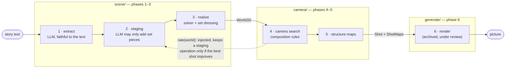

# FrameSeeker

From a moment in a story to a cinematic shot. An LLM writes the moment as a scene (who stands where, what hits
what); code builds a gray-box 3D stage of it; a camera search scores thousands of viewpoints with **deterministic
composition rules** from the film and photography literature (no AI judge); and the best shots come out as structure
maps (depth, line art, pose, region masks) for an image renderer.

Why: image models draw well but cannot be told *where the camera is*. A striking frame is mostly composition:
camera height, angle, lens, what frames the subject. That part is geometry, so it is solved as geometry.

**Contents:** [How it works](#how-it-works) · [Architecture](#architecture) · [The camera scorer](#the-camera-scorer) ·
[Does it agree with directors?](#does-it-agree-with-directors) · [Generation (phase 6)](#generation-phase-6-archived-under-review) ·
[Run](#run) · [Status](#status)

---

## How it works

Six phases, in three modules:



| Phase | Input → output | Who decides |
|---|---|---|
| 1. Extract | story text → **scene JSON**: actors (pose, placement, look), structures, effects, the moment (focus, intent) | an LLM, told to add nothing the text does not say; the solver checks its answer |
| 2. Staging | scene JSON → scene JSON with set pieces added | an LLM proposes; each addition is kept only if the camera score rises (and drops when taken out) |
| 3. Realize | scene JSON → **gray-box 3D world**: mannequins in poses, boxes, cylinders, glass, beams, the place's dressing | code: a relation solver, then set dressing by the kind of place |
| 4. Camera search | world → the best *k* **shots** that differ | code: thousands of random cameras, hard constraints, composition terms, local refinement |
| 5. Structure maps | world + camera → depth, line art, OpenPose, a mask per person / effect / structure / part of the set, each person's planned joints and facing | code: one ray pass |
| 6. Render | scene + shot + maps → picture | an image renderer (see [Generation](#generation-phase-6-archived-under-review)) |

Phases 3–5 are deterministic: the same scene gives the same shots.

---

## Architecture

### Modules and what each may use


An arrow means "uses". Two rules, checked by `tests/architecture.test.ts` on every test run:

1. **A module is used only through its `index.ts`.** Everything else in it is private and can be rewritten freely,
   so one module can be improved (or replaced) without touching the others. (`shared/` is a library of independent
   files and may be imported file by file.)
2. **Dependencies point down only.** The scene never knows the camera exists; the camera never knows how its maps
   are rendered.

The one place the scene needs the camera, staging (phase 2 asks "does this set piece make a better shot?"), the
camera's `rate` is passed in as a function by the pipeline, so the dependency still points down.

### What crosses each boundary

| From → to | What | Type (defined in) |
|---|---|---|
| story → scene | the text, an optional focus ("draw the moment when…"), people's descriptions | `buildScenes(text, …)` |
| scene → camera | the solved world: the scene JSON, its exact geometry (actors' joints, structures, beams, blasts, damage), the ray-castable primitives | `World3D` (scene/index.ts) |
| camera → scene, staging only | the best shot's score and terms, through an injected function | `Rating` (scene/index.ts) |
| camera → generate | a shot (camera, score, measurements) and its maps (images, region masks, planned people) | `Shot`, `ShotMaps` (camera/index.ts) |
| generate → caller | the picture and whatever the renderer reports | `GenerateResult` (generate/types.ts) |
| scene, camera → eval | `realize`; `scorer(world)`: score a camera, draw the search's random cameras, search; camera geometry | camera/index.ts |

### Inside each module

**`shared/`** — no dependencies.
`vec.ts` 3D vectors · `geom.ts` primitives (box, capsule / cylinder, sphere; glass) and ray casting · `skeleton.ts`
the OpenPose body-18 format every module speaks · `image.ts`, `png.ts` raw images and PNG.

**`scene/`** — phases 1–3. Public: `buildScenes`, `realize`, the scene and world types, the pose library.
`types.ts` the scene JSON · `llm/` extraction (`extract.ts`), staging proposals (`stage.ts`), the vocabulary shown
to the LLM, written from the code (`vocab.ts`), a chat client (`chat.ts`) · `judge.ts` keeps a staging operation
only where it measurably helps · `solve.ts` relations → exact geometry · `poses.ts` the pose library ·
`dress.ts` dressing by the kind of place (streets of buildings, a room's shell, a classroom's blackboard and desks).

**`camera/`** — phases 4–5. Public: `shoot`, `rate`, `rateCamera`, `scorer`, `maps`, `preview`, camera geometry.
`camera.ts` the pinhole camera and projection · `search.ts` sampling and local refinement · `score.ts` hard
constraints and score terms · `composition2d.ts` picture-plane composition (Liu et al. 2010) · `maps.ts` the
structure maps · `render.ts` the gray-box preview for people.

**`generate/`** — phase 6. Public: the renderer contract (`Generator`, `GenerateInput`, `GenerateResult`). No
renderer in this version.

**`eval/`** — the scorer against films. Public: `evalRef`, `rebuild`.
`refs.ts` rebuilds an annotated film frame as a gray-box scene and its camera · `eval.ts` ranks that camera.

**`pipeline.ts`** — `runText` (phases 1–6) and `runScene` (3–6). **`cli/`** — the commands below.

---

## The camera scorer

Hard constraints first (the subject and the payoff visible, the action line not running into the lens, …), then
terms in [0, 1] combined by a weighted geometric mean, each from a published rule or measured data:

- **picture-plane composition**: rule of thirds for subjects and lines, diagonal dominance, visual balance, region
  size (Liu, Chen, Wolf, Cohen-Or 2010, with the paper's constants);
- **shot scale**: the frequencies of film shot scales (Cutting 2015, 13 956 frames from 48 films); action shots blend
  these with reference action shots;
- **face angle**: how often reference shots show the front, three-quarter and back, over a uniform camera;
- **camera tilt**, the same way: near top-down shots (over 45° down) are 2 of 88 reference shots against 13% of
  random cameras; other tilts are as common as chance, or too rare among random cameras to judge;
- **framing, lead room, foreshortening** of the action line, **joint cuts** on the subject, **occlusion** of the
  subject by nearer people or glass (Bares et al. 2000), **mergers**.

The weights depend on the shot's intent (scale, action, emotion, reveal).

## Does it agree with directors?

Frames are sampled every 10 s from anime episodes and filtered by fixed rules (no cherry-picking); 15 per episode
are annotated by hand (horizon, people's crowns and feet) and rebuilt as gray-box scenes with the camera that shot
them, by single-view metrology. The measure: where the director's camera ranks among the search's random valid
cameras.

Held-out episodes (the scorer frozen before each one, each run once):

| Episode | Studio | Director's shot in the top 5% |
|---|---|---|
| Oregairu S1 ep 12 | Brain's Base | 8 / 15 |
| Log Horizon ep 4 | Satelight | 5 / 14 (action shots wider than expected; fixed after) |
| Mahouka ep 22 | Madhouse | 12 / 15 |
| GATE ep 6 | A-1 Pictures | 11 / 15 |

On all 88 rebuilt shots (the six episodes so far): 59 in the top 5%, the director's camera among the search's top 3
in 24. Known weak spots: backs and wide establishing shots; the shot scale of action scenes (two episodes disagree);
a person lying down can be "visible" from a camera that cannot read them. The frames and annotations stay local; the
evaluation code is in `src/eval/`.

---

## Generation (phase 6): archived, under review

A renderer gets the scene, the shot and its maps, and makes its own prompt (`src/generate/types.ts`): an
image-board model wants tags, another XML or sentences.

The first renderer, SDXL + ControlNet on ComfyUI (run on Comfy Cloud), is on branch
[`archive/phase6-sdxl-comfy`](../../tree/archive/phase6-sdxl-comfy) (tag `phase6-sdxl-comfy-v1`). Most of its work
went into patching known weaknesses of that stack, which newer multi-character, structure-controlled renderers may
already solve; so phase 6 is being reconsidered as a thin adapter onto one of them. What the archived renderer
learned, as requirements for whatever comes next:

- **Each thing's words only in its own region.** People, effects, structures and the labelled parts of the set each
  get their own prompt inside their own mask; the free-text description of the place never reaches a wall. With
  everyone in one prompt, hair and gender swapped between people, "melting" melted whatever the model chose, and
  "evening light through the windows" put windows on gray-box walls.
- **Which way someone faces comes from the pose, not the depth** (a featureless mannequin has the same depth front
  and back); a person seen from behind gets no expression tags.
- **The set loosely, the people firmly**: firm depth on bare stand-in walls fights the prompt (windows painted flat).
- **Thin effects need more than structure maps** (a beam is a few pixels of depth): a colour hint helped.
- **Glass**: its shape in the depth, except over a person behind it.
- **Measure, then pick**: the image model leaned to drawing girls and no prompt lever fixed it. Drawing 4 candidates
  and measuring each with existing instruments (DWPose for who is where and facing which way, a Danbooru tagger for
  each person's gender), compared with the plan by plain geometry, picked a right picture whenever there was one.

---

## Run

Node ≥ 24 (runs TypeScript directly, no build), no runtime dependencies.

```
npm install
npm test                                              # includes the architecture check
npm run frameseeker -- scenes/classroom-talk.json     # phases 3–5 from a scene file → out/run-classroom-talk/
npm run frameseeker -- stories/rooftop-chase.txt      # phases 1–5 from a story (needs VENICE_API_KEY)
```

| Command | Phases | For |
|---|---|---|
| `npm run frameseeker -- <story.txt \| scene.json>` | 1–5 (3–5 from a scene file); 6 with `--generator` | the whole pipeline |
| `npm run stage -- <story.txt>` | 1–3 | inspecting extraction and staging |
| `npm run shot -- <scene.json>` | 3–5 | inspecting the camera search: previews, maps, every score term |
| `npm run eval` | — | the scorer against the annotated film frames (local data) |
| `npm run refs:select` | — | sampling reference frames by the fixed rules (local data) |

Each shot comes out as a gray-box preview, depth, line art, OpenPose, a mask per region (each person, effect,
structure and labelled part of the set), each person's planned joints and facing (`report.json`), and a colour hint
when an effect is in frame. Example scenes are in `scenes/`, example stories in `stories/`.

## Status

Phases 1–5 work end to end. Phase 6 ran on Comfy Cloud with the archived renderer (the pictures kept the gray box's
composition); which renderer to use next is being decided after an outside review.
