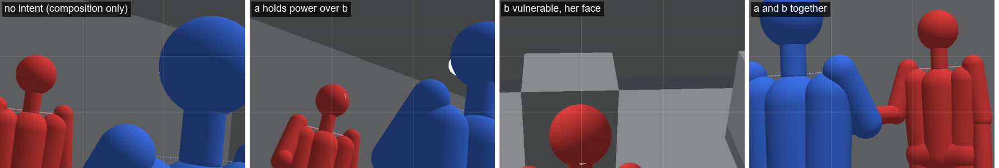
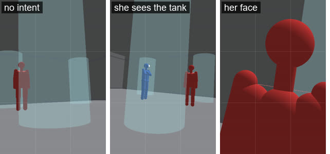
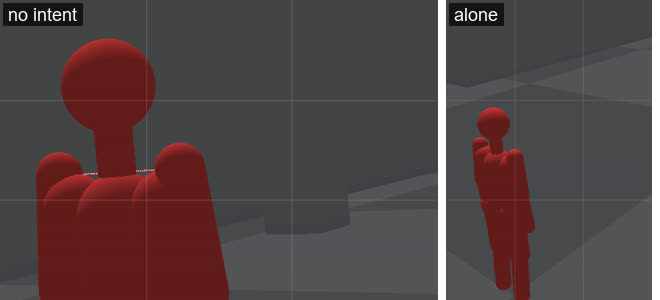

# Intent: what a shot is for

*Design draft, 2026-11-18. The first version is implemented in `src/intent/`; what is open is marked as such.*

## The problem

FrameSeeker's camera scorer answers one question: **is this frame well made?** Rule of thirds, shot scale, face
angle, tilt, occlusion: composition, measured against what directors do. It does not answer the question that comes
first: **what is this shot for?** What must the viewer notice, understand, feel?

Without that question, every new camera feature is a patch for a symptom. The back shots scored low, so a gaze
feature was built to explain them; it found no clean signal (see [Gaze](#gaze-status)), because a back shot is not good
or bad by itself: it is right when the shot is about what the person sees, and wrong when it is about their face.
Lighting, viewpoint, frontality, vanishing lines and emotion would each go the same way: one at a time, unrelated.

So two questions are kept apart:

- **Composition**: how the things in frame are arranged so the picture follows photographic practice.
- **Cinematographic intent**: why the story needs this picture; what the viewer should notice, understand and feel.

## What the literature does

The same split runs through the work on automatic cinematography:

| Work | How intent enters |
|---|---|
| Jhala & Young 2005, *A Discourse Planning Approach to Cinematic Camera Control* | Three levels: geometric composition, camera parameters for affect, coherence across shots. A shot is a communicative act that changes what the viewer believes; e.g. a low angle for dominance, a close shot for an angry speaker. |
| Lai, Wu, Sanokho, Christie, Li 2014, *A Pattern-based Tool for Creating Virtual Cinematography* | Communicative goals (build emotion, isolation, affinity) → techniques (e.g. *intensify*: each cut closer) → shot specifications, looked up in a database of shots annotated from real films. |
| Bian et al. 2026, *Look-Before-Move* | Directorial intent → a *semantic observation contract* (subjects, relations, what must be visible, composition preferences) → Monte Carlo viewpoint search. Its search half is FrameSeeker's phase 4; its contract half is what FrameSeeker lacked. |
| Zhang et al. 2026, *FilmFlow* | An *Interpreter* agent extracts scene-grounded cinematographic intent before planning. (Its *Critic* is a vision-language model judging renders; FrameSeeker keeps judging deterministic.) |

## Three layers

```
story ──► INTENT ──► DEVICES ──► COMPOSITION ──► camera
          what the     how films     is the frame
          viewer must  convey it     well made?
          understand
```

1. **Intent** (`src/intent/types.ts`): a small structured vocabulary. An LLM writes it from the story, as it writes
   the scene; code checks it against the scene's ids.
2. **Devices** (`src/intent/devices.ts`): for each kind of intent, the ways films convey it, as deterministic
   preferences over what a camera shows. One intent may have several devices; it is met when any of them is.
3. **Composition** (`src/camera/score.ts`): the existing scorer, unchanged.

The camera module knows nothing of intent. It exposes a neutral measurement of what a camera shows (`View`: for each
person and thing, how much is in frame and seen, where, how big; for each person, the face angle, the camera's
height against their eyes, whether what they look at is in frame) and accepts a list of `Preference`s, each folded
into the score with a weight (the composition score counts as one). The intent module turns an intent into those
preferences. Lighting or vanishing lines would be new devices, and new measurements in `View`, not new intents.

### The vocabulary (first version)

| Intent | Device(s) | Source |
|---|---|---|
| `face(who)` — read their face | face within 30–75° of the camera, medium shot or closer | Mascelli: the close-up for reaction |
| `sees(who, target)` — what they look at | (a) both in one frame (over the shoulder, two-shot); (b) point of view: the camera at their eyes | Mascelli; Arijon: external reverse |
| `power(who, over?)` — they hold power | low angle: camera below their eyes, looking up | Mascelli: camera angles; Jhala & Young |
| `vulnerable(who)` — small, weak, overwhelmed | high angle: camera above, looking down | Mascelli: camera angles |
| `alone(who)` | nobody else in frame, the person small in it | Mascelli: space around a figure |
| `together(who…)` — they belong together now | all in one frame at sizes alike | Arijon: the two-shot |
| `scale(who, against)` — small against something big | the big thing in frame, many times the person's size | (FrameSeeker's scale shot) |

Each shot has a `subject` (where the eye goes first) and up to three things to convey, most important first.

### What the old `moment` becomes

The scene's `moment` (focus, must-show ids, action line, payoff, an intent label of four values) was a first, rough
intent, mixed into the scene and enforced as hard constraints. With an intent given, `applyIntent` derives it: the
subject is the focus; what the intent needs is what must be in frame; the action line and the payoff stay hard
constraints only if the intent names them. (Before, a reaction shot of the researcher was impossible because the
scene demanded the tank in frame.) Without an intent, nothing changes.

## Trying it

`npm run shot -- scenes/classroom-talk.json --intent intents/classroom-a-power.json`. The same scene, different
intents, the search's best camera:





(The gray-box heads have no faces; "her face" means the camera is in front of it.)

## What is open

- **The weights** of the devices against composition are a first choice (each intent as much as the whole composition
  score, the first one a half more), not measured.
- **Evaluation.** Evaluation A asks whether the scorer picks the director's camera, without knowing what the director
  meant: the reference frames carry a rough intent label from a fixed rule. With an intent layer, the question becomes
  *given this intent, which device did the director use?*, and the reference frames need their intent annotated from
  the story around them (the shots before and after), not from the frame alone.
- **Sequences.** Many intents live across cuts (*intensify*: each shot closer); FrameSeeker plans one shot at a time.
- **Feel and light.** Emotional tone (tension, warmth) is an intent; light is mostly how it is served. Two kinds:
  - *Mood light* (low key or high key, warm or cold, contrast) is set relative to the camera and the subject (the
    classic three-point setup: key about 45° to one side of the lens, back light behind the subject facing it). So it
    comes **after** the camera is chosen: a lighting layer (e.g. Blender) lights the chosen shot from the intent's
    feel. The camera search need not know about it. (The user's proposal, 2026-11-18.)
  - *Light that belongs to the world* (the sun, a window, a street lamp, the glow of a blast) is placed by the story
    and constrains the camera: a silhouette needs the camera facing the light. It is a scene fact, and "silhouette",
    "backlit" and the like are devices scored during the search, not added afterwards.
  So: intent (feel) → camera search (world lights as facts, light devices as preferences) → lighting layer (mood light
  for the chosen camera) → render.
- **The face's weight against the intent** (does the face angle matter only when the face matters?): measured on the
  annotated shots and on 119 shots with text-only intents. The direction holds (directors show backs far more often
  when nobody names the face), but intents written by an LLM from text do not tell when the face matters as the
  annotators judge it, and no weighting beat the current face term out of sample or in evaluation A. The scorer is
  unchanged; when a better source of intent exists, the face term would become p·(face table) + (1 − p), with p
  measured as P(the face matters | intent). Asking the LLM instead for the reasons film scholarship gives for a back
  (Bordwell 1985: shame or grief hidden, absorption, watching something further off, hidden identity, following
  someone who walks away) looked promising on the 119 shots it was chosen on, and failed on 45 new shots from three
  new episodes, frozen beforehand: the people it flagged were shown from the front or the side, not from behind.
- **Extraction** (`extractIntent`) is written and checked against the scene's ids, but not yet run on stories.

## Pointing: who the eye goes to

Films point the viewer's eye at someone or something in many ways: the people in the picture look, point, aim or walk
toward it; someone speaks (the eye goes to the speaker); a beam or a throw flies at it; light falls on it; lines lead
to it. Each such fact is a **cue** (`src/scene/attention.ts`): what it points at (a person or a structure), its kind,
whose it is, a weight. Cues come from small sources, one per kind, so a new kind is a new source and nothing else.

The same cues serve two layers:

- **Story cues** are facts of the scene, true whatever the camera: `looks_at` (else the id they face), `approaches`
  (whom they walk toward), `aim` (pointing, firing, punching), line effects, and `speaking` (a cue at the speaker
  themselves, not at whom they speak to). They tell whom the moment is about, so the focus the LLM chose (the
  moment's focus, or the intent's subject) is checked against them: the one with the most support (each source counted
  once per target) is compared with it, and when they differ and at least two sources support the other one, the
  solver adds a note. The focus's own cues at others are left out (what they look at is what they see, not a rival).
  It is a check, not a rule: a reaction shot is about the one who looks.
- **Frame cues** (not built): light, leading lines, size and place in the picture. They depend on the camera and the
  lighting; they are how a director sends the eye to the focus, so they belong to the camera search and the lighting
  layer (see *Feel and light*) as preferences, not to choosing the focus.

Every kind weighs 1 for now. Measured on the 30 annotated tasks (four annotators): with who faces whom taken from the
reference frames' head directions, people pointed at by 0, 1 and 2+ others got 1.7, 2.0 and 2.7 of 4 attention votes
(within-shot permutation p 0.07). From the text alone (the pipeline's scene extractor, which writes facing, looks_at,
approaches and speaking for every actor, two runs), the support a person gets tracks the votes closely: 0, 1 and 2+
sources give about 1.4, 2.4 and 3.1 of 4 votes. The person with the most support is the annotators' plurality on 7 of
11–12 shots, the extractor's own focus on 12–13 of 18, so the cues are a check on the focus, not a replacement. The
check fires on 2–4 of 27 shots with two or more people, and has not yet corrected a focus the annotators agree on: once
it named the speaker where all four chose the one walking away, the other times the annotators were split or chose the
place.

## Gaze: status

*Kept for when gaze returns as a device for `sees`.*

- **Built.** A person can look at something: `looks_at` in the scene (an id, an anchor, or a world point for what is
  not built, like the sky), resolved by the solver; by default the id they face. The camera's `View` says whether that
  point is in frame. The reference frames record what the focus looks at.
- **Measured** on 117 annotated reference shots, and not used for scoring:
  - whether the gaze target is in frame does not tell a director's back shot from a random one (94% against 89%:
    from behind, what someone faces is in frame anyway);
  - "looks at a far view" went with back shots in 7 of 7, but that is an artefact of annotating single frames: a view
    behind the camera cannot be told from a person standing there, so front-facing view gazes were never labelled.
- **Next, under the intent layer:** annotate the reference frames' gaze targets from the surrounding shots
  (shot/reverse shot), then measure, for shots whose intent is `sees`, how often directors choose a back, an
  over-the-shoulder or a point-of-view shot.
